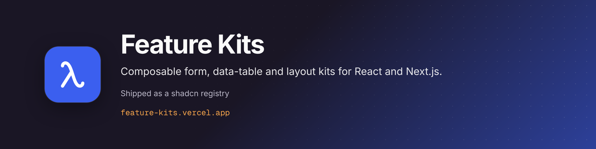

<p align="center"></p>

# Feature Kits

**Composable form, data-table and layout kits for React and Next.js. Shipped as a shadcn registry.**

**Live docs:** [feature-kits.vercel.app](https://feature-kits.vercel.app)

Feature Kits (repo and registry namespace: `feature-kit`) is a set of open-source UI kits for product engineering.

## Kits

Registry items (from `registry.json`), installable from `https://feature-kits.vercel.app/r/<name>.json`:

| Kit | What it includes |
| --- | --- |
| `form` | FormKit and FieldKit — Zod schemas with React Hook Form |
| `data-table` | TanStack Table wrapper with filters, bulk actions, and URL sync |
| `layout` | Form sections, navigation helpers, confirmation dialog, and shared layout utilities |
| `dashboard-shell` | DashboardShell, header, sidebar nav, and account menu composition |
| `breadcrumb` | Route-derived breadcrumbs with ellipsis menu and copy URL |
| `auth` | Better Auth wiring, sign-in/up modules, and a demo-friendly memory adapter |
| `theme` | next-themes provider, toggle, selector, and preference sync |
| `uploader` | Spreadsheet import UI with validation and FormKit integration |

Blocks: `blocks-dashboard-overview`, `blocks-data-table-crud`, `blocks-detail-page`, `blocks-settings-area`, `blocks-auth-pages`, `blocks-uploader-import`, `blocks-app-states`, `blocks-top-nav-app`.

Shared primitives live in `packages/ui` (shadcn-style Field\*, inputs, overlays) and `packages/format`.

## Repository layout

```
apps/web          # Next.js playground and documentation shell
feature/form
feature/data-table
feature/layout
feature/uploader
feature/auth
feature/theme
feature/export
feature/preferences
packages/ui
packages/format
packages/config   # shared TypeScript config
```

## Use the kits in your app

The workspace packages are `private` and are not published to npm. There are two ways to use them:

1. **shadcn registry (external apps):** the kits are served as a shadcn registry. Each kit resolves to `https://feature-kits.vercel.app/r/<kit>.json` (item names: `form`, `data-table`, `dashboard-shell`, `layout`, `breadcrumb`, `auth`, `theme`, `uploader`). The CLI copies the source into your project:

   ```bash
   npx shadcn@latest add https://feature-kits.vercel.app/r/form.json
   ```

   See [Installation](https://feature-kits.vercel.app/docs/installation) for configuring the `@feature-kit` namespace.

2. **Workspace packages (inside this monorepo):** add `"form": "workspace:*"` (and so on) to an app in this repo and list the packages in `transpilePackages`.

## Develop

Requires Node.js 24+ and pnpm 9+ (`engines` in `package.json`; the repo pins `pnpm@10.12.1`).

```bash
git clone https://github.com/jayantrohila57/feature-kit.git
cd feature-kit
pnpm install
pnpm dev
```

`pnpm registry:build` regenerates the registry; `pnpm build` runs it and then builds the docs app.

Open [http://localhost:3000](http://localhost:3000), then **[`/docs`](http://localhost:3000/docs)** for kit overviews and live previews (FormKit, FieldKit, DataTable, Uploader, layout utilities, and more). Legacy `/examples`, `/form`, and `/table` redirect into the docs.

**Documentation** — Fumadocs MDX in `apps/web/content/docs` (no sidebar; horizontal kit nav). Runnable demos are embedded on kit pages and under `/docs/examples/*`.

## Brand


**Composable form, data-table and layout kits for React and Next.js.**

Brand assets live in [`.github/brand`](.github/brand): logo mark (SVG and PNG), wordmark (SVG), light and dark lockups, app icons (512, 192 and 32 px), an Open Graph image (1200×630), a GitHub social preview (1280×640), this README banner, an X/LinkedIn banner (1500×500) and a palette sheet.

| Role | Hex | Source |
| --- | --- | --- |
| Brand primary (mark, CTA) | `#3b5fef` | `BRAND_PRIMARY / --primary` |
| Surface dark | `#1a1625` | `BRAND_SURFACE_DARK` |
| Surface light | `#f4f3f8` | `BRAND_SURFACE_LIGHT` |
| Background (light) | `#fbfaf8` | `--background` |
| Foreground | `#0a0a0a` | `--foreground` |

Type: System UI sans in the app (`system-ui, sans-serif` in the OG image); brand images are set in Inter, with Geist Mono for code.

## License

[MIT](LICENSE)

## Sponsor

If you find this project useful, consider supporting its development:

[](https://github.com/sponsors/jayantrohila57)
